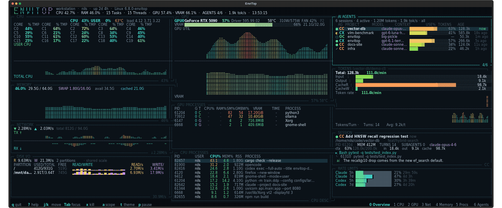

# envitop

A single terminal dashboard that looks like [btop](https://github.com/aristocratos/btop),
shows NVIDIA GPUs like [nvitop](https://github.com/XuehaiPan/nvitop), and tracks local AI
coding agents like [abtop](https://github.com/abtop-dev/abtop).



The animation shows each tab for two seconds at 24 frames per second, using one continuous simulated system.

```
┌ CPU ──────────────────────┐┌ GPU ──────────────────────────┐┌ AI AGENTS ─────────────────────┐
│ 36.4%  4.82 GHz  63°C     ││ GPU0 RTX 5090  80%  58°C 315W ││ 4 sessions · 2 active · 1.9k/s │
│          ⢀⣀⣠⣴⣶⣿⣿⣿⣿⣶⣦⣄⡀ ││          ⢀⣀⣠⣴⣶⣿⣿⣿⣶⣦⣄⣀⡀     ││ ● CC vector-db  ctx ███░░ 63%  │
│  core bars, load average  ││ VRAM bar + utilisation graph  ││ ◐ CX vlm-bench  ctx ██░░░ 41%  │
└───────────────────────────┘└───────────────────────────────┘└────────────────────────────────┘
```

## Features

- **btop-style system view** — split CPU total/user and RAM/swap histories,
  two-column per-core bars with temperatures, cached and available memory,
  network RX/TX, per-partition read/write histories and used/free storage.
- **nvitop-style GPU view** — utilisation and VRAM graphs, temperature, power,
  fan, clocks, p-state, driver/CUDA versions, and per-process SM%, GMBW%, VRAM
  allocation, runtime and model/project details where available.
- **Multi-GPU cluster view** — overview pools VRAM capacity and power, averages
  utilization across devices, and layers per-GPU histories in stable colors.
- **abtop-style agent view** — Claude Code, Codex CLI and OpenCode sessions with
  status, model, project, context usage, a token breakdown and rate, recent
  tool calls, child processes/ports and a chat tail.
- **Rate limits** — reads the same local statusline caches abtop uses for
  Claude/Codex 5-hour and 7-day quota windows.
- **Kill flow** — `x` asks for confirmation before sending `SIGTERM`; the
  OpenCode shared server and envitop itself are protected.
- **Tabbed diagnostics** — keep the current dashboard as Overview and open
  CPU, GPU, Net, Memory, Procs, and Agents as focused views.
- **Memory, disks, and filesystems together** — the Memory tab combines RAM
  and swap, disk activity, mount capacity, filesystem type, and inode use.
- **Unified process details** — the Procs tab includes GPU-only PIDs and joins
  GPU index, type, SM%, GMBW%, VRAM, and runtime to host CPU/memory metrics.
- **Process filtering** — search the combined host/GPU table with `/` or `f`.
- **Network attribution** — show active process owners per interface and
  Linux TCP byte rates when the local `ss` tool exposes socket counters. The
  Net tab also lists listening ports and locally hosted HTTP services with
  links, status codes, process IDs, and likely entry-file paths.
- **Agent workspace** — includes session context, token/cache usage, child
  processes, ports, current task, model, memory, turns, and recent activity.
- **Timeline and insights** — scrub the latest 120 samples globally; current
  measurement-backed insights appear in the tab bar instead of extra tabs.
- **Responsive layout** — each focused tab fills the available terminal width.
- **Component-focused layouts** — CPU cores sit beside split user/total history
  and top processes; GPU commands sit beside device telemetry; Memory combines
  RAM, disk and filesystem detail; Net pairs its graph with interface tables.
- **Themes** — btop, Adapta, Dracula, Gruvbox and Nord, cycled with `t`.
- **Read-only by default** — no API keys or external network requests. The Net
  tab sends bounded `HEAD` requests only to local listening web services.
  Other data comes from `/proc`, `psutil`, `nvidia-smi` and local transcript files.

## Tab guide

Press `0`–`6` to open a tab. The [tab guide](docs/tabs/README.md) describes
what each view shows and links to a focused page for each one.

## Related project

[Syswatch](https://github.com/matthart1983/syswatch/tree/main) is a related
system-monitoring project.

## Requirements

- Linux (the process/GPU collectors assume `/proc` and `nvidia-smi`).
- Python 3.9 or newer.
- `textual` and `psutil` (installed automatically).
- Optional: an NVIDIA driver with `nvidia-smi` on `PATH` for GPU telemetry.
- Optional: Claude Code, Codex CLI or OpenCode histories for the agent panel.

## Install and run

Install the latest published release from PyPI:

```bash
python3 -m pip install envitop
envitop
```

From a checkout, without installing:

```bash
./envitop.sh
```

Build and run the initial native Rust monitor with its low-overhead `/proc` and `/sys` sampler:

```bash
./native/build.sh
ENVITOP_NATIVE=1 ./envitop.sh
```

The regular launcher continues to use the full Textual interface. Set
`ENVITOP_PYTHON=1` to force it when `ENVITOP_NATIVE=1` is also set. The native
monitor reuses the Python agent collector as a background sidecar. Session
navigation and the remaining interactive controls are still being ported.

Or install the `envitop` command:

```bash
python3 -m pip install -e .
envitop
```

## Build and publish

Build the wheel and source distribution, then check their metadata:

```bash
python3 -m pip install --upgrade build twine
python3 -m build
python3 -m twine check dist/*
```

Upload to TestPyPI first, then publish to PyPI after checking the install:

```bash
python3 -m twine upload --repository testpypi dist/*
python3 -m pip install --index-url https://test.pypi.org/simple/ envitop
python3 -m twine upload dist/*
```

Set `TWINE_USERNAME=__token__` and the appropriate `TWINE_PASSWORD` token in
your shell before uploading. Each release needs a new version in `pyproject.toml`.

Useful flags:

```bash
envitop --demo                 # synthetic data, no GPU/agents required
envitop --theme adapta         # btop (default), dracula, gruvbox, nord, adapta
envitop --scope all            # include agent sessions from the last 24 h
envitop --once                 # print one text snapshot and exit
envitop --json                 # print one JSON snapshot and exit
```

## Keys

| Key | Action |
| --- | --- |
| `j` / `k`, arrows | move selection |
| `tab` / `shift+tab` | cycle focus between visible process tables and agent sessions |
| `0`–`6` | Overview / CPU / GPU / Net / Memory / Procs / Agents |
| Procs header click | cycle that column through ascending, descending, and unsorted |
| `f` in Procs | search across all host and GPU process fields |
| `/` in Procs | enter a column regex such as `PID/150` or `T/C`; invalid queries show no rows |
| `←` / `→`, `Home` / `End` | scrub Timeline samples |
| `a` | toggle agent scope: last 30 min ↔ last 24 h |
| `p` | pause/resume sampling |
| `r` | force a refresh |
| `t` | cycle colour theme |
| `x`, then `y` / `n` | kill selected process/agent, confirm/cancel |
| `?` | open help (scroll with arrows/page keys, any other key closes) |
| `q` | quit |

## Data sources

| Panel | Source |
| --- | --- |
| CPU, memory, swap, network, disk, processes | `psutil` and `/proc` |
| Temperatures | `psutil.sensors_temperatures()` where available |
| GPU stats | `nvidia-smi --query-gpu=...` |
| GPU driver/CUDA versions | `nvidia-smi` header |
| Per-process SM%, GMBW% and framebuffer allocation | `nvidia-smi pmon -s um -c 1`, with compute-apps fallback for VRAM |
| Claude Code sessions | `~/.claude/projects/**/*.jsonl` |
| Codex sessions | `~/.codex/sessions/**/*.jsonl` (and archived rollouts) |
| OpenCode sessions | `~/.local/share/opencode/opencode.db` (SQLite, read-only) |
| Claude/Codex quotas | `~/.claude/abtop-rate-limits.json`, `~/.cache/abtop/codex-rate-limits.json` |

Agent discovery is intentionally conservative: missing directories simply yield
an empty panel. OpenCode's database is opened read-only and queried by recency so
large databases do not trigger a full scan.

## Metric guide

| Metric | Meaning |
| --- | --- |
| CPU% in the process table | Share of total machine CPU capacity used by one process. A process using all logical CPUs is 100%; one fully busy thread on a 24-thread machine is about 4.2%. |
| Tasks / Threads | Number of visible system processes and the sum of their reported OS thread counts. |
| Per-core CPU% | Utilization of that logical CPU. CPU temperatures use available hardware sensors. |
| RAM used / available / cached | Host memory in use, available for applications, and used by the kernel page cache. Cached memory is generally reclaimable. |
| SWAP used | Host swap allocation, reported separately from RAM. |
| GPU utilization | Percent of the sample interval during which one or more GPU kernels were executing. |
| GPU MBW | Percent of the sample interval during which device memory was being read or written, as reported by NVIDIA. This is a bandwidth activity percentage, not a byte-per-second rate. |
| Multi-GPU utilization | Mean utilization across visible devices. Each GPU contributes `its utilization / device count` to the stacked overview graph. |
| Pooled GPU memory | Used VRAM divided by total VRAM across visible devices; per-device graph layers are weighted by each device's memory capacity. |
| GPU memory used / total | Device framebuffer (VRAM) currently allocated, as reported by NVIDIA. This is capacity use, not bandwidth activity. |
| GPU process VRAM | Framebuffer memory allocated to that process. The table shows an em dash when NVIDIA does not expose a value. |
| GPU process SM% | Per-process streaming-multiprocessor activity averaged over the latest `pmon` sample interval. |
| GPU process GMBW% | Per-process global-memory bandwidth activity averaged over the latest `pmon` sample interval. NVIDIA reports this as memory activity; it is not VRAM capacity or a byte-per-second measurement. |
| GPU process CPU% / MEM% | Host CPU and system RAM used by the process. CPU% is normalized to total machine capacity; MEM% is the process share of host RAM. |
| GPU process TIME | Elapsed time since the operating system reports the process start time. It is unavailable if the process cannot be matched locally. |
| Disk read/write rate | Current per-partition bytes read/written per second. Graph peaks are scaled to the recent observed history, not a hardware maximum. |
| Network RX/TX | Bytes received/transmitted per second; RX and TX histories use mirrored graph directions. |
| Interface link max | Maximum interface speed reported by the operating system; virtual interfaces may not report a meaningful limit. |
| Interface process list | Processes with visible active sockets mapped to that interface by their local address or kernel-selected route. Permissions may hide sockets. |
| Agent context | Tokens in the current context divided by the model's available context window. Token rate is the observed change in active tokens over time. |

The GPU heading includes the NVIDIA driver version and the CUDA version reported
by `nvidia-smi`, formatted as `Driver <version> | CUDA <version>`. Process
bandwidth and activity fields may be unavailable on unsupported GPU/driver
combinations; those values display as `—` instead of being estimated.

## Development

```bash
python3 -m unittest discover -s tests -v
python3 -m compileall -q envitop
ruff check envitop tests
```

Project layout:

```
envitop/
  app.py                  Textual app, layout, keys, and actions
  app.tcss                dashboard styles
  widgets/                tab panels, graphs, tables, header/footer
  draw/                   palettes, formatting, bars, and graphs
  model.py                shared dataclasses
  sampler.py              background sampling thread
  demo.py                 synthetic data source
  collectors/             system, GPU, Claude, Codex, and OpenCode sources
demo/
  generate_demo.py        animated tab-tour generator
docs/
  tabs/                   guide to each dashboard tab
```

## Notes and limitations

- Monitoring is read-only. Killing is only triggered by an explicit `x` + `y`.
  Demo mode disables killing, because its PIDs are synthetic.
- AI-agent records are parsed from local files written by each tool; their
  schemas can change between releases.
- The OpenCode entry point is a shared server process, so envitop refuses to kill
  it. Kill a child session/port instead.
- `nvidia-smi` is invoked at the sampling interval; on systems where it is slow
  or unsupported the GPU panel degrades to an explanatory message. NVIDIA may
  report process framebuffer usage or utilization as unavailable on some
  devices, drivers, or MIG configurations.
- The UI targets modern UTF-8 terminals with braille glyph support. A Nerd Font
  is not required.
