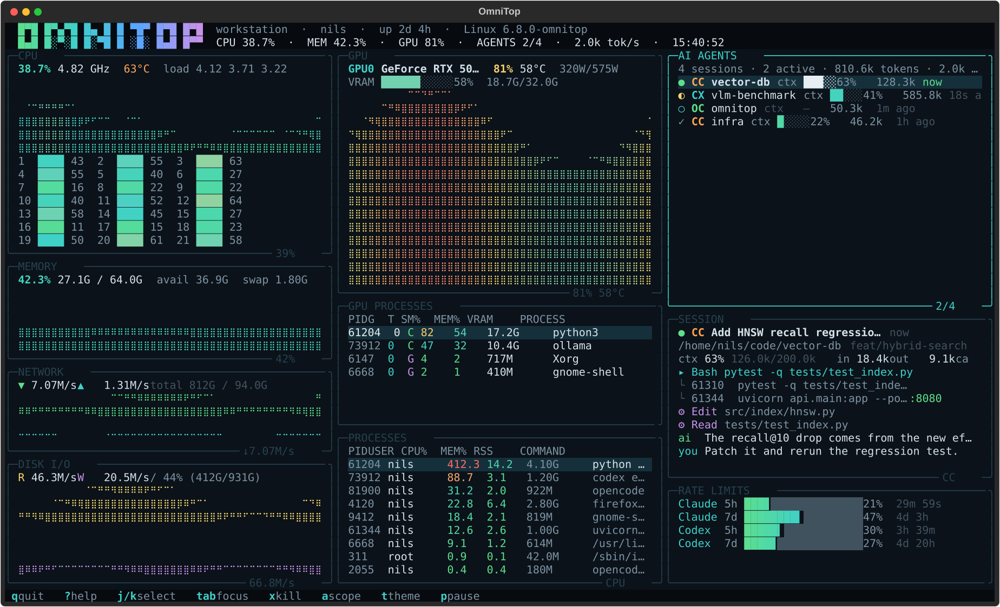

# omnitop

A single terminal dashboard that looks like [btop](https://github.com/aristocratos/btop),
shows NVIDIA GPUs like [nvitop](https://github.com/XuehaiPan/nvitop), and tracks local AI
coding agents like [abtop](https://github.com/abtop-dev/abtop).



```
┌ CPU ───────────────────────────┐┌ GPU ───────────────────────────┐┌ AI AGENTS ─────────────────────┐
│ 36.4%  4.82 GHz  63°C          ││ GPU0 RTX 5090  80%  58°C 315W  ││ 4 sessions · 2 active · 1.9k/s │
│          ⢀⣀⣠⣴⣶⣿⣿⣿⣿⣶⣦⣄⡀        ││          ⢀⣀⣠⣴⣶⣿⣿⣿⣶⣦⣄⡀      ││ ● CC vector-db  ctx ███░░ 63%  │
│  core bars, load average       ││ VRAM bar + utilisation graph  ││ ◐ CX vlm-bench  ctx ██░░░ 41%  │
└────────────────────────────────┘└────────────────────────────────┘└────────────────────────────────┘
```

## Features

- **btop-style system view** — CPU graph and per-core bars, memory/swap, network
  RX/TX history, disk read/write history and filesystem usage, process table
  with sorting.
- **nvitop-style GPU view** — utilisation and VRAM graphs, temperature, power,
  fan, clocks, p-state, and a per-process table with SM%, memory and VRAM.
- **abtop-style agent view** — Claude Code, Codex CLI and OpenCode sessions with
  status, model, project, context usage, token totals, token rate, recent tool
  calls, child processes/ports and a chat tail.
- **Rate limits** — reads the same local statusline caches abtop uses for
  Claude/Codex 5-hour and 7-day quota windows.
- **Kill flow** — `x` asks for confirmation before sending `SIGTERM`; the
  OpenCode shared server and omnitop itself are protected.
- **Responsive layout** — three columns on wide terminals; `1`/`2`/`3` switch
  between system, GPU and agent views on narrow terminals.
- **Themes** — btop, Dracula, Gruvbox and Nord, cycled with `t`.
- **Read-only by default** — no API keys and no network requests; everything is
  collected from `/proc`, `psutil`, `nvidia-smi` and local transcript files.

## Requirements

- Linux (the process/GPU collectors assume `/proc` and `nvidia-smi`).
- Python 3.9 or newer.
- `textual` and `psutil` (installed automatically).
- Optional: an NVIDIA driver with `nvidia-smi` on `PATH` for GPU telemetry.
- Optional: Claude Code, Codex CLI or OpenCode histories for the agent panel.

## Install and run

From a checkout, without installing:

```bash
./omnitop.sh
```

Or install the `omnitop` command:

```bash
python3 -m pip install -e .
omnitop
```

Useful flags:

```bash
omnitop --demo                 # synthetic data, no GPU/agents required
omnitop --theme nord           # btop (default), dracula, gruvbox, nord
omnitop --scope all            # include agent sessions from the last 24 h
omnitop --once                 # print one text snapshot and exit
omnitop --json                 # print one JSON snapshot and exit
```

## Keys

| Key | Action |
| --- | --- |
| `j` / `k`, arrows | move selection |
| `tab` / `shift+tab` | cycle focused panel (or view when narrow) |
| `1` / `2` / `3` | system / GPU / agents view (narrow terminals) |
| `a` | toggle agent scope: last 30 min ↔ last 24 h |
| `s` | sort processes by CPU ↔ memory |
| `p` | pause/resume sampling |
| `r` | force a refresh |
| `t` | cycle colour theme |
| `x`, then `y` / `n` | kill selected process/agent, confirm/cancel |
| `?` | open help (scroll with arrows/page keys, any other key closes) |
| `q` | quit |

## Data sources

| Panel | Source |
| --- | --- |
| CPU, memory, swap, network, disk, processes | `psutil` and `/proc` |
| Temperatures | `psutil.sensors_temperatures()` where available |
| GPU stats | `nvidia-smi --query-gpu=...` |
| Per-process SM%/memory | `nvidia-smi pmon -c 1` with a compute-apps fallback |
| Claude Code sessions | `~/.claude/projects/**/*.jsonl` |
| Codex sessions | `~/.codex/sessions/**/*.jsonl` (and archived rollouts) |
| OpenCode sessions | `~/.local/share/opencode/opencode.db` (SQLite, read-only) |
| Claude/Codex quotas | `~/.claude/abtop-rate-limits.json`, `~/.cache/abtop/codex-rate-limits.json` |

Agent discovery is intentionally conservative: missing directories simply yield
an empty panel. OpenCode's database is opened read-only and queried by recency so
large databases do not trigger a full scan.

## Development

```bash
python3 -m unittest discover -s tests -v
python3 -m compileall -q omnitop
ruff check omnitop tests
```

Project layout:

```
omnitop/
  app.py                 Textual app, layout, keys, kill flow
  widgets.py             panels, graphs, tables, header/footer
  draw.py                palettes, formatting, bars, braille graphs
  model.py               shared dataclasses
  sampler.py             background sampling thread
  demo.py                synthetic data source
  collectors/system.py   psutil collectors
  collectors/gpu.py      nvidia-smi collectors
  collectors/agents.py   Claude/Codex/OpenCode/rate-limit collectors
  cli.py                 argparse entry point
```

## Notes and limitations

- Monitoring is read-only. Killing is only triggered by an explicit `x` + `y`.
  Demo mode disables killing, because its PIDs are synthetic.
- AI-agent records are parsed from local files written by each tool; their
  schemas can change between releases.
- The OpenCode entry point is a shared server process, so omnitop refuses to kill
  it. Kill a child session/port instead.
- `nvidia-smi` is invoked at the sampling interval; on systems where it is slow
  or unsupported the GPU panel degrades to an explanatory message.
- The UI targets modern UTF-8 terminals with braille glyph support. A Nerd Font
  is not required.
